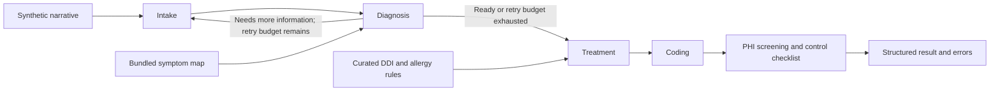

# Medical Multi-Agent System

[](https://github.com/HenryVarro666/medical-multi-agent-system/actions/workflows/ci.yml)
[](pyproject.toml)
[](LICENSE)

A Python research prototype that runs a synthetic patient narrative through five stages: intake, diagnosis, treatment, coding, and audit. LangGraph controls the workflow, and FastAPI exposes the pipeline and deterministic lookup tools.

The project demonstrates agent orchestration, retrieval traces, deterministic drug-interaction checks, and reproducible evaluation artifacts. It is not clinically validated, HIPAA certified, or intended for patient care. Use synthetic data only.

Adapted from [bcefghj/medical-multi-agent-system](https://github.com/bcefghj/medical-multi-agent-system), under the MIT license. See [attribution and project history](ATTRIBUTION.md).

## What runs today

- Four LLM stages produce structured intake, diagnosis, treatment, and coding outputs. A deterministic audit stage screens outputs with limited PHI regex patterns and marks deployment controls as unverified.
- Diagnosis retrieves candidates from a small, bundled symptom-to-disease map and includes the retrieval trace in its output. The default pipeline does not query Neo4j or a literature corpus.
- Treatment reconciles LLM suggestions with curated drug-interaction and allergy rules. These rules are illustrative and incomplete.
- ICD-10 lookup and simplified DRG grouping use bundled mappings. They do not replace a complete coding catalog or certified grouper.
- Evaluation records per-run outputs, scoring, errors, and latency for five synthetic vignettes.

## Architecture

[](docs/assets/architecture/system-architecture.svg)

The four LLM stages share the model client factory; Audit runs deterministic checks. State lasts for one invocation by default. See [architecture details and diagram sources](docs/architecture.md) for the implemented boundaries and regeneration command.

## Quick start

Use Python 3.11 or newer; `.python-version` selects Python 3.12 for uv. Run these commands from the repository root:

```bash
python3 -m venv .venv
source .venv/bin/activate
python -m pip install -e '.[dev]'
cp .env.example .env
```

Set `OPENAI_API_KEY` in `.env` to use the default OpenAI backend. Alternatively, point the application at an already running OpenAI-compatible model server:

```dotenv
OPENAI_BASE_URL=http://localhost:8001/v1
OPENAI_API_KEY=local
OPENAI_MODEL=your-served-model
```

The model server is a separate dependency and is not launched by this repository. Keep it on a different port from the API. `LLM_DISABLE_THINKING` defaults to `false`; enable it only if the server supports `chat_template_kwargs.enable_thinking`.

Start the API:

```bash
uvicorn medical_multi_agent.api.main:app --host 127.0.0.1 --port 8000
```

Open [Swagger UI](http://127.0.0.1:8000/docs) or [ReDoc](http://127.0.0.1:8000/redoc). The health, ICD-10, and DDI endpoints work without an LLM. Full analysis requires a working configured backend. `/health` checks the API process, not model readiness.

For an installation using the committed dependency lockfile, use uv:

```bash
uv sync --extra dev --locked
uv run uvicorn medical_multi_agent.api.main:app --host 127.0.0.1 --port 8000
```

## Try the API

A deterministic interaction check:

```bash
curl -s http://127.0.0.1:8000/api/v1/clinical/ddi/check \
  -H 'Content-Type: application/json' \
  -d '{"new_drugs":["warfarin"],"current_drugs":["aspirin"]}'
```

Run a bundled synthetic vignette through the full pipeline:

```bash
python - <<'PY'
import json
from pathlib import Path
import httpx

case = json.loads(Path("data/sample_patients.json").read_text())[0]
response = httpx.post(
    "http://127.0.0.1:8000/api/v1/clinical/analyze",
    json={"patient_description": case["description"]},
    timeout=600,
)
response.raise_for_status()
print(json.dumps(response.json(), indent=2))
PY
```

Inspect the returned `errors` list as well as the HTTP status; individual agent failures can produce partial results. See the [API reference](docs/api.md).

For a complete recorded input-to-result walkthrough, see the [end-to-end example](#end-to-end-example).

## Workflow

[](docs/assets/architecture/agent-workflow.svg)

Agents read and update a shared `ClinicalState` in the numbered sequence. Intake, Diagnosis, Treatment, and Coding use the LLM; Audit is deterministic. Click either architecture diagram for its vector version.

<details>
<summary>Compact workflow in Mermaid</summary>



</details>

Retries reprocess the same narrative; the API does not collect new information from a user. Once the retry budget is exhausted, the current workflow proceeds with the available information. See [architecture and limitations](docs/architecture.md).

## End-to-end example

This walkthrough uses **`case_001`, repeat 1**, from the July 13, 2026 evaluation with `Qwen/Qwen3-14B`. It displays the input and five stored stage-result sections from the [original pipeline trace](evaluation/results/historical-2026-07-13/raw/case_001_r1.json). The evaluation harness invoked the graph directly; the record is a historical pipeline result, not a captured HTTP response or a new run of the refactored code.

Each expandable block contains the complete recorded JSON for that stage, with no fields omitted. Medication, interaction, coding, confidence, and reference fields are unverified model outputs. They are shown to explain the software workflow and are not clinical instructions or validated citations.

### Input

> 45-year-old male presenting with fever (39.2°C) for 3 days, productive cough with yellow sputum, and right-sided chest pain that worsens with deep breathing. History of type 2 diabetes (diagnosed 5 years ago) and hypertension. Current medications: metformin 500mg twice daily, lisinopril 10mg daily. Allergies: penicillin (causes rash). Vital signs: BP 130/85, HR 102, RR 22, SpO2 94% on room air. Labs: WBC 15,000/μL (elevated), CRP 85 mg/L (elevated), procalcitonin 2.1 ng/mL (elevated). Chest X-ray shows right lower lobe consolidation.

The API accepts this narrative as `patient_description` and passes it to the graph as `raw_input`. The fixture labels used for scoring are `Community-Acquired Pneumonia` and ICD-10 `J18.1`; these labels are not included in the model input.

### 1. Intake → `patient_info`

Intake reads `raw_input` and extracts a 45-year-old male patient, symptoms, diabetes/hypertension history, two current medications, a penicillin allergy, vital signs, and lab results. This structured object becomes the input to Diagnosis.

<details>
<summary>Complete Intake output</summary>

```json
{
  "patient_id": null,
  "name": "Unknown",
  "age": 45,
  "gender": "male",
  "chief_complaint": "fever, productive cough with yellow sputum, and right-sided chest pain that worsens with deep breathing",
  "symptoms": [
    {
      "name": "fever",
      "duration_days": 3,
      "severity": "severe",
      "description": "temperature of 39.2°C"
    },
    {
      "name": "productive cough",
      "duration_days": 3,
      "severity": "moderate",
      "description": "with yellow sputum"
    },
    {
      "name": "right-sided chest pain",
      "duration_days": 3,
      "severity": "moderate",
      "description": "worsens with deep breathing"
    }
  ],
  "medical_history": [
    "type 2 diabetes",
    "hypertension"
  ],
  "family_history": [],
  "allergies": [
    {
      "substance": "penicillin",
      "reaction": "causes rash",
      "severity": "mild"
    }
  ],
  "current_medications": [
    {
      "name": "metformin",
      "dosage": "500mg",
      "frequency": "twice daily",
      "start_date": null
    },
    {
      "name": "lisinopril",
      "dosage": "10mg",
      "frequency": "daily",
      "start_date": null
    }
  ],
  "vital_signs": {
    "temperature": 39.2,
    "heart_rate": 102,
    "blood_pressure_systolic": 130,
    "blood_pressure_diastolic": 85,
    "respiratory_rate": 22,
    "oxygen_saturation": 94.0
  },
  "lab_results": [
    {
      "test_name": "WBC",
      "value": "15,000/μL",
      "unit": "/μL",
      "reference_range": "4,500–11,000",
      "is_abnormal": true
    },
    {
      "test_name": "CRP",
      "value": "85 mg/L",
      "unit": "mg/L",
      "reference_range": "< 10",
      "is_abnormal": true
    },
    {
      "test_name": "procalcitonin",
      "value": "2.1 ng/mL",
      "unit": "ng/mL",
      "reference_range": "< 0.5",
      "is_abnormal": true
    }
  ],
  "raw_input": null,
  "created_at": "2026-07-12T19:46:04.668905"
}
```

</details>

### 2. Diagnosis → `diagnosis`

Diagnosis reads `patient_info` and retrieves five bundled symptom-map candidates. The first candidate is `Influenza`, with one symptom match; the LLM selects `Community-acquired pneumonia`, reports confidence `0.85`, and records its differentials and retrieval trace. Confidence is model-reported, not calibrated accuracy. The archive records one diagnosis attempt.

<details>
<summary>Complete Diagnosis output</summary>

```json
{
  "primary_diagnosis": {
    "disease_name": "Community-acquired pneumonia",
    "icd10_hint": "J18.9",
    "confidence": 0.85,
    "evidence": [
      "productive cough with yellow sputum",
      "right-sided chest pain that worsens with deep breathing (pleuritic chest pain)",
      "fever of 39.2°C",
      "elevated WBC (15,000/μL), elevated CRP (85 mg/L), and elevated procalcitonin (2.1 ng/mL) indicating bacterial infection"
    ],
    "reasoning": "The combination of fever, productive cough with yellow sputum, pleuritic chest pain, and elevated inflammatory markers (WBC, CRP, procalcitonin) strongly suggests a bacterial infection, most likely community-acquired pneumonia. The presence of pleuritic chest pain and yellow sputum further supports this diagnosis."
  },
  "differential_list": [
    {
      "disease_name": "Sepsis",
      "icd10_hint": "A41.9",
      "confidence": 0.6,
      "evidence": [
        "fever",
        "elevated WBC, CRP, and procalcitonin"
      ],
      "reasoning": "Sepsis can present with fever and systemic inflammatory markers. However, the absence of systemic signs such as hypotension, tachycardia beyond what is already present, or altered mental status makes sepsis less likely as the primary diagnosis."
    },
    {
      "disease_name": "Influenza",
      "icd10_hint": "J11.1",
      "confidence": 0.5,
      "evidence": [
        "fever"
      ],
      "reasoning": "Influenza can cause fever and cough, but it typically does not present with pleuritic chest pain or such markedly elevated inflammatory markers. Additionally, influenza is less likely to cause such a high procalcitonin level, which is more indicative of bacterial infection."
    },
    {
      "disease_name": "Pneumothorax",
      "icd10_hint": "J93.1",
      "confidence": 0.4,
      "evidence": [
        "right-sided chest pain that worsens with deep breathing"
      ],
      "reasoning": "Pneumothorax can cause pleuritic chest pain, but it is not typically associated with fever, productive cough, or elevated inflammatory markers. A chest X-ray would be necessary to confirm or rule out this diagnosis."
    }
  ],
  "recommended_tests": [
    "Chest X-ray to confirm pneumonia or other pulmonary pathology",
    "Sputum culture and sensitivity to identify the causative organism",
    "Blood culture to rule out sepsis",
    "Chest CT scan if the chest X-ray is inconclusive"
  ],
  "clinical_notes": "The patient presents with signs and symptoms consistent with community-acquired pneumonia, supported by elevated inflammatory markers. Sepsis and influenza are considered differentials, but the clinical picture is more consistent with a bacterial infection. Further diagnostic testing is recommended to confirm the diagnosis and guide treatment.",
  "knowledge_sources": [
    "UpToDate: Community-Acquired Pneumonia",
    "CDC: Influenza and Sepsis Guidelines",
    "ICD-10-CM Diagnosis Code Lookup",
    "GraphRAG knowledge graph (symptom->disease retrieval)"
  ],
  "knowledge_graph_candidates": [
    {
      "disease": "Influenza",
      "symptom_match_count": 1,
      "icd10_code": "J11.1",
      "icd10_description": "Influenza with other respiratory manifestations"
    },
    {
      "disease": "Pneumonia",
      "symptom_match_count": 1,
      "icd10_code": "J18.9",
      "icd10_description": "Pneumonia, unspecified organism"
    },
    {
      "disease": "COVID-19",
      "symptom_match_count": 1,
      "icd10_code": "U07.1",
      "icd10_description": "COVID-19, virus identified"
    },
    {
      "disease": "Sepsis",
      "symptom_match_count": 1,
      "icd10_code": "A41.9",
      "icd10_description": "Sepsis, unspecified organism"
    },
    {
      "disease": "Malaria",
      "symptom_match_count": 1,
      "icd10_code": "",
      "icd10_description": ""
    }
  ]
}
```

</details>

### 3. Treatment → `treatment_plan`

Treatment reads the patient information and diagnosis. The LLM proposes `Levofloxacin` and `Acetaminophen` and supplies four interaction descriptions. The deterministic engine checks the proposed drugs against `metformin`, `lisinopril`, and the `penicillin` allergy, recording `checked: true`, **zero curated-rule interaction matches**, and zero rule-based allergy alerts. This stamp does not verify the LLM interaction text or establish medication safety.

<details>
<summary>Complete Treatment output</summary>

```json
{
  "diagnosis_addressed": "Community-acquired pneumonia",
  "medications": [
    {
      "drug_name": "Levofloxacin",
      "generic_name": "Levofloxacin",
      "dosage": "500mg",
      "route": "oral",
      "frequency": "once daily",
      "duration": "7 days",
      "contraindications": [
        "hypersensitivity to fluoroquinolones",
        "tendinitis or tendon rupture risk in elderly patients"
      ],
      "side_effects": [
        "nausea",
        "headache",
        "dizziness",
        "photosensitivity",
        "gastrointestinal upset"
      ]
    },
    {
      "drug_name": "Acetaminophen",
      "generic_name": "Acetaminophen",
      "dosage": "500mg",
      "route": "oral",
      "frequency": "every 4–6 hours as needed",
      "duration": "as needed for fever",
      "contraindications": [
        "severe liver disease",
        "alcoholism"
      ],
      "side_effects": [
        "nausea",
        "rash",
        "hepatotoxicity (rare)"
      ]
    }
  ],
  "drug_interactions": [
    {
      "drug_a": "Levofloxacin",
      "drug_b": "Lisinopril",
      "severity": "minor",
      "description": "Levofloxacin may increase the risk of hypoglycemia in patients taking ACE inhibitors like lisinopril, though this is rare.",
      "recommendation": "Monitor for signs of hypoglycemia and adjust lisinopril dosage if necessary."
    },
    {
      "drug_a": "Levofloxacin",
      "drug_b": "Metformin",
      "severity": "minor",
      "description": "Levofloxacin may increase the risk of lactic acidosis in patients taking metformin, though this is rare.",
      "recommendation": "Monitor for signs of lactic acidosis and consider alternative antibiotics if risk is high."
    },
    {
      "drug_a": "Acetaminophen",
      "drug_b": "Lisinopril",
      "severity": "none",
      "description": "No significant interaction between acetaminophen and lisinopril.",
      "recommendation": "No action required."
    },
    {
      "drug_a": "Acetaminophen",
      "drug_b": "Metformin",
      "severity": "none",
      "description": "No significant interaction between acetaminophen and metformin.",
      "recommendation": "No action required."
    }
  ],
  "non_drug_treatments": [
    "Hydration with oral fluids",
    "Chest physiotherapy to aid sputum clearance"
  ],
  "lifestyle_recommendations": [
    "Rest and avoid strenuous activity",
    "Maintain good hand hygiene",
    "Avoid smoking and secondhand smoke"
  ],
  "follow_up_plan": "Follow up in 48–72 hours to assess clinical improvement. If no improvement, re-evaluate for possible antibiotic resistance or complications. Repeat chest X-ray if symptoms persist.",
  "warnings": [
    "Monitor for signs of antibiotic resistance (e.g., worsening symptoms, new fever), allergic reactions to levofloxacin, and signs of lactic acidosis (e.g., nausea, abdominal pain, weakness). Avoid sun exposure while on levofloxacin due to photosensitivity risk."
  ],
  "evidence_references": [
    "UpToDate: Community-Acquired Pneumonia",
    "CDC Guidelines for the Treatment of Community-Acquired Pneumonia",
    "American Thoracic Society (ATS) and Infectious Diseases Society of America (IDSA) Guidelines"
  ],
  "allergy_alerts": [],
  "ddi_engine": {
    "checked": true,
    "proposed_drugs_checked": [
      "Levofloxacin",
      "Acetaminophen"
    ],
    "current_medications_checked": [
      "metformin",
      "lisinopril"
    ],
    "allergies_checked": [
      "penicillin"
    ],
    "engine_flagged_interactions": 0,
    "engine_flagged_allergy_alerts": 0
  }
}
```

</details>

### 4. Coding → `coding_result`

Coding reads the diagnosis and treatment plan and proposes primary ICD-10 `J18.9` and DRG `193`, plus secondary codes. These are LLM-generated proposals. The primary code differs from the fixture label `J18.1`, so the recorded exact-code check fails while the `J18` category check matches.

<details>
<summary>Complete Coding output</summary>

```json
{
  "primary_icd10": {
    "code": "J18.9",
    "description": "Pneumonia, unspecified organism",
    "confidence": 0.92,
    "category": "Infectious and parasitic diseases"
  },
  "secondary_icd10_codes": [
    {
      "code": "R07.0",
      "description": "Pleuritic chest pain",
      "confidence": 0.85,
      "category": "Symptoms, signs, and abnormal clinical and laboratory findings, not elsewhere classified"
    },
    {
      "code": "R74.0",
      "description": "Elevated white blood cell count",
      "confidence": 0.8,
      "category": "Symptoms, signs, and abnormal clinical and laboratory findings, not elsewhere classified"
    },
    {
      "code": "R79.0",
      "description": "Elevated C-reactive protein",
      "confidence": 0.75,
      "category": "Symptoms, signs, and abnormal clinical and laboratory findings, not elsewhere classified"
    }
  ],
  "drg_group": {
    "drg_code": "193",
    "description": "Pneumonia, unspecified, with major complications or comorbidities",
    "weight": 1.2,
    "mean_los": 4.5
  },
  "coding_notes": "The primary diagnosis of community-acquired pneumonia is supported by clinical symptoms (productive cough, pleuritic chest pain, fever) and laboratory findings (elevated WBC, CRP, and procalcitonin). J18.9 is the most specific ICD-10-CM code for unspecified pneumonia. Secondary codes include pleuritic chest pain (R07.0), elevated WBC (R74.0), and elevated CRP (R79.0). DRG 193 is appropriate for pneumonia with complications or comorbidities, with a realistic weight and mean length of stay.",
  "coding_confidence": 0.9
}
```

</details>

### 5. Audit → `audit_result`

Audit scans the four preceding structured outputs. The historical report flags `name`, sets `hipaa_compliant: false`, and reports risk `medium`. The old implementation also claimed `phi_fields_masked: ["name"]` and marked deployment controls `Verified`; those claims did not establish actual redaction or control verification. The current implementation reports deployment controls as unverified and does not claim to have masked the returned data. The archived JSON below is retained unchanged.

<details>
<summary>Complete historical Audit output</summary>

```json
{
  "hipaa_compliant": false,
  "compliance_checks": [
    {
      "check_name": "phi_scan",
      "passed": false,
      "detail": "Found 1 PHI types: name"
    },
    {
      "check_name": "data_encryption_at_rest",
      "passed": true,
      "detail": "Verified"
    },
    {
      "check_name": "data_encryption_in_transit",
      "passed": true,
      "detail": "Verified"
    },
    {
      "check_name": "access_control_rbac",
      "passed": true,
      "detail": "Verified"
    },
    {
      "check_name": "audit_logging",
      "passed": true,
      "detail": "Verified"
    },
    {
      "check_name": "minimum_necessary_rule",
      "passed": true,
      "detail": "Verified"
    },
    {
      "check_name": "breach_notification_ready",
      "passed": true,
      "detail": "Verified"
    },
    {
      "check_name": "data_retention_policy",
      "passed": true,
      "detail": "Verified"
    }
  ],
  "phi_fields_found": [
    "name"
  ],
  "phi_fields_masked": [
    "name"
  ],
  "audit_trail": [
    {
      "timestamp": "2026-07-13T00:46:25.598644+00:00",
      "user_id": "system",
      "action": "phi_scan",
      "resource_type": "pipeline_output",
      "resource_id": "",
      "detail": "Scanned 4 sections",
      "outcome": "success",
      "ip_address": ""
    },
    {
      "timestamp": "2026-07-13T00:46:25.602111+00:00",
      "user_id": "system",
      "action": "data_masking",
      "resource_type": "pipeline_output",
      "resource_id": "",
      "detail": "Masked 1 PHI types",
      "outcome": "success",
      "ip_address": ""
    },
    {
      "timestamp": "2026-07-13T00:46:25.602255+00:00",
      "user_id": "system",
      "action": "compliance_assessment",
      "resource_type": "pipeline",
      "resource_id": "",
      "detail": "Overall: NEEDS_REVIEW, risk=medium",
      "outcome": "success",
      "ip_address": ""
    }
  ],
  "recommendations": [
    "Ensure all PHI is masked before external transmission",
    "Review failed compliance checks and remediate",
    "Maintain audit logs for minimum 6 years per HIPAA requirements"
  ],
  "overall_risk_level": "medium"
}
```

</details>

### Final recorded result

All five stage-result sections are present in the final `pipeline_output`. The outcome below combines those sections with the [recorded scoring row](evaluation/results/historical-2026-07-13/eval_results.json).

| Item | Recorded result |
|---|---|
| Primary diagnosis | `Community-acquired pneumonia` |
| Diagnosis alias tier | `strict` |
| Fixture / predicted ICD-10 | `J18.1` / `J18.9` |
| Exact ICD-10 / category match | `false` / `true` |
| Treatment proposal | `Levofloxacin`, `Acetaminophen`; unverified model output |
| Deterministic treatment checks | Executed; 0 curated-rule interaction matches, 0 rule-based allergy alerts |
| Historical audit | `hipaa_compliant: false`; `name` flagged; legacy masking/control claims are unsupported |
| Diagnosis attempts | `1` |
| Stored pipeline `errors` / `harness_error` | `null` / `null` (no errors recorded) |
| End-to-end latency | **27.10 seconds** |

The pipeline completed this demonstration run, while the exact ICD-10 check did not match and the audit report flagged an identifier pattern. The trace preserves these outcomes and the original model text for inspection.

With a configured backend, run the same fixture against the current code:

```bash
python -m evaluation.run_eval --cases case_001 --repeats 1
```

This creates a separate result directory. Model outputs may differ, and the current audit behavior includes the corrections described above.

## Evaluation

### Recorded results

The original July 13, 2026 run used `Qwen/Qwen3-14B` through a local OpenAI-compatible endpoint. Five synthetic cases were run twice, producing ten recorded pipeline outputs. The original results remain displayed below and are preserved in the [full report](evaluation/results/historical-2026-07-13/eval_results.md), [machine-readable summary](evaluation/results/historical-2026-07-13/eval_results.json), and [raw outputs](evaluation/results/historical-2026-07-13/raw/).

[](docs/assets/evaluation/historical-metrics.svg)

[](docs/assets/evaluation/historical-latency.svg)

The charts are generated from the preserved JSON. Click either chart for its vector version; see [figure regeneration](evaluation/README.md#readme-figures) for the command. Exact values and all ten raw runs remain below.

| Recorded measure | Original field | Result |
|---|---|---:|
| Top-1 diagnosis, strict alias tier | `diagnosis_top1_strict` | 6/10 (60%) |
| Top-1 diagnosis, either alias tier | `diagnosis_top1_any` | 10/10 (100%) |
| Top-3 diagnosis, either alias tier | `diagnosis_top3_any` | 10/10 (100%) |
| Exact ICD-10 match | `icd10_exact` | 5/10 (50%) |
| ICD-10 category match | `icd10_category` | 10/10 (100%) |
| Treatment structure complete | `treatment_ok` | 10/10 (100%) |
| Deterministic DDI check executed | `ddi_engine_checked` | 10/10 (100%) |
| Audit report produced | `audit_completed` | 10/10 (100%) |
| Mean pipeline latency | `mean_latency_seconds` | 28.22 s |

`treatment_ok` measures the presence of medications and a DDI execution stamp. `audit_completed` measures whether a report exists. These fields do not assess treatment safety or establish compliance.

<details>
<summary>Show all ten original per-case results</summary>

Each case links to its original raw pipeline output. “Plan” is the historical `treatment_ok` structural check; “DDI” and “Audit” indicate execution/report completion.

| Case | Expected diagnosis | Predicted diagnosis | Top-1 tier | Top-3 | Expected ICD | Predicted ICD | ICD exact | ICD category | Plan | DDI | Audit | Latency (s) |
|---|---|---|---|---|---|---|---|---|---|---|---|---:|
| [case_001 r1](evaluation/results/historical-2026-07-13/raw/case_001_r1.json) | Community-Acquired Pneumonia | Community-acquired pneumonia | strict | yes | J18.1 | J18.9 | no | yes | yes | yes | yes | 27.10 |
| [case_002 r1](evaluation/results/historical-2026-07-13/raw/case_002_r1.json) | ST-Elevation Myocardial Infarction (STEMI) | Acute myocardial infarction | compatible | yes | I21.0 | I21.9 | no | yes | yes | yes | yes | 29.16 |
| [case_003 r1](evaluation/results/historical-2026-07-13/raw/case_003_r1.json) | Hypothyroidism (Hashimoto's Thyroiditis) | Hypothyroidism | strict | yes | E03.9 | E03.9 | yes | yes | yes | yes | yes | 24.38 |
| [case_004 r1](evaluation/results/historical-2026-07-13/raw/case_004_r1.json) | Acute Decompensated Heart Failure | Heart Failure with Reduced Ejection Fraction (HFrEF) | compatible | yes | I50.9 | I50.21 | no | yes | yes | yes | yes | 35.92 |
| [case_005 r1](evaluation/results/historical-2026-07-13/raw/case_005_r1.json) | Acute Appendicitis | Appendicitis | strict | yes | K35.80 | K35.80 | yes | yes | yes | yes | yes | 24.29 |
| [case_001 r2](evaluation/results/historical-2026-07-13/raw/case_001_r2.json) | Community-Acquired Pneumonia | Community-acquired pneumonia | strict | yes | J18.1 | J18.9 | no | yes | yes | yes | yes | 27.48 |
| [case_002 r2](evaluation/results/historical-2026-07-13/raw/case_002_r2.json) | ST-Elevation Myocardial Infarction (STEMI) | Acute myocardial infarction | compatible | yes | I21.0 | I21.9 | no | yes | yes | yes | yes | 30.52 |
| [case_003 r2](evaluation/results/historical-2026-07-13/raw/case_003_r2.json) | Hypothyroidism (Hashimoto's Thyroiditis) | Hypothyroidism | strict | yes | E03.9 | E03.9 | yes | yes | yes | yes | yes | 26.83 |
| [case_004 r2](evaluation/results/historical-2026-07-13/raw/case_004_r2.json) | Acute Decompensated Heart Failure | Congestive Heart Failure (CHF) | compatible | yes | I50.9 | I50.9 | yes | yes | yes | yes | yes | 33.62 |
| [case_005 r2](evaluation/results/historical-2026-07-13/raw/case_005_r2.json) | Acute Appendicitis | Appendicitis | strict | yes | K35.80 | K35.80 | yes | yes | yes | yes | yes | 22.90 |

</details>

These are historical demo measurements, not results for the current refactor. Diagnosis scoring uses substring aliases; it does not assess clinical correctness. Repeats reuse the same five cases, labels have not been independently validated, and there is no baseline comparison or demonstrated GraphRAG improvement. The historical files retain their original wording and outputs for traceability.

### Run a new evaluation

After configuring a backend, create a new run:

```bash
python -m evaluation.run_eval --help
python -m evaluation.run_eval --repeats 2
python -m evaluation.run_eval --cases case_001 --output-dir /tmp/clinical-eval-new
```

New outputs default to an ignored, timestamped directory under `evaluation/results/runs/`. Historical results and nonempty output directories cannot be overwritten by the runner. See [evaluation methods and reproduction limits](evaluation/README.md).

## Development

```bash
python -m pytest
python -m ruff check .
```

The automated tests exercise the graph and agents with synthetic fixtures and mocked model calls; they also cover the API and evaluation runner. They do not require an LLM or clinical data. CI checks Python 3.11, 3.12, and 3.13, builds the package, and runs container smoke tests. A live evaluation is a separate check requiring a model backend.

```text
src/medical_multi_agent/   Agents, graph, API, models, configuration, services
data/                     Five synthetic vignette fixtures
tests/                    Offline regression tests
evaluation/               Scoring, runner, and historical artifacts
docs/                     Architecture and API reference
```

## Docker

```bash
cp .env.example .env
# Configure the backend in .env before full analysis.
docker compose up --build
```

Compose runs the API alone. For a model server running on the host, set `OPENAI_BASE_URL=http://host.docker.internal:8001/v1`. PostgreSQL and Redis are not used by the default pipeline. Neo4j connection helpers are optional and are not wired into diagnosis retrieval.

## Scope and limitations

The audit stage runs after LLM calls and does not redact the returned patient data. Remote model configuration sends narrative and intermediate data to the selected endpoint. This application has no authentication or durable audit storage. FHIR conversion helpers are experimental, are not invoked by the pipeline, and have not been validated against an external FHIR server.

The project is licensed under [MIT](LICENSE). Contributions should preserve the evidence boundaries described in [CONTRIBUTING.md](CONTRIBUTING.md).
