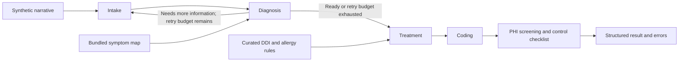

# Medical Multi-Agent System

[](https://github.com/HenryVarro666/Medical-Multi-Agent-System/actions/workflows/ci.yml)
[](pyproject.toml)
[](LICENSE)

A Python research prototype for a five-stage clinical workflow: Intake, Diagnosis, Treatment, Coding, and Audit. LangGraph orchestrates the Agents; FastAPI exposes analysis and deterministic lookup endpoints.

Use synthetic data only. The project is not clinically validated or HIPAA certified.

## Contents

- [Overview](#overview)
- [Quick start](#quick-start)
- [Model configuration](#model-configuration)
- [Try the API](#try-the-api)
- [Architecture and Agent workflow](#architecture)
- [End-to-end example](#end-to-end-example)
- [Evaluation](#evaluation)
- [Docker](#docker)
- [Development](#development)
- [Troubleshooting](#troubleshooting)
- [Scope and attribution](#scope-and-attribution)

## Overview

| Component | Implemented behavior |
|---|---|
| Agent workflow | Four LLM stages followed by deterministic Audit, with bounded diagnosis retries |
| Retrieval | A small bundled symptom map; candidates and retrieval traces enter Diagnosis |
| Treatment checks | Curated DDI/allergy rules reconcile the model's proposal |
| Offline API tools | Health, ICD-10 search/lookup, simplified DRG mapping, and DDI checks |
| Evaluation | Five synthetic fixtures, preserved historical runs, and reproducible figures |

The API and offline tools require no model server, GPU, or database. Full analysis requires a configured OpenAI-compatible model backend. Neo4j/FHIR helpers are outside the default workflow.

## Quick start

### 1. Clone and install

Install Git and [uv](https://docs.astral.sh/uv/getting-started/installation/). The commands below use macOS/Linux shell syntax. This repository is private; Git credentials must belong to an account with access.

```bash
git clone https://github.com/HenryVarro666/Medical-Multi-Agent-System.git
cd Medical-Multi-Agent-System
uv python install 3.12
uv sync --locked --managed-python
cp .env.example .env
```

The managed Python path avoids dependence on the system interpreter. uv creates `.venv` and installs the committed dependency versions. CI tests Python 3.11, 3.12, and 3.13; Python 3.12 is the default here.

For PowerShell, use `Copy-Item .env.example .env` for the last step. Keep all later commands in the repository root. The uv commands do not require virtual-environment activation.

<details>
<summary>Alternative: install with pip and an existing Python 3.12</summary>

After cloning and entering the repository:

```bash
python3.12 -m venv .venv
source .venv/bin/activate
python -m pip install -e .
cp .env.example .env
```

On Windows, create the environment with `py -3.12 -m venv .venv` and activate it with `.venv\Scripts\Activate.ps1` in PowerShell. Use `Copy-Item` to create `.env`.

For this installation path, replace `uv run --locked python` with `python` in later examples. Keep the venv active in each terminal. pip resolves compatible version ranges; it does not use `uv.lock`.

</details>

### 2. Start the API

In terminal 1, leave the server running:

```bash
uv run --locked python -m uvicorn medical_multi_agent.api.main:app --host 127.0.0.1 --port 8000
```

With pip, run the same command without `uv run --locked` in the activated venv. You can start the API with the unchanged `.env` template; credentials are needed only for full analysis.

### 3. Verify the offline endpoints

In terminal 2, run:

```bash
curl --fail http://127.0.0.1:8000/health
curl --fail http://127.0.0.1:8000/api/v1/clinical/icd10/J18.9
curl --fail http://127.0.0.1:8000/api/v1/clinical/ddi/check \
  -H 'Content-Type: application/json' \
  -d '{"new_drugs":["warfarin"],"current_drugs":["aspirin"]}'
```

All three requests should return HTTP 200. The DDI example should report `has_major_interaction: true`. Open [Swagger UI](http://127.0.0.1:8000/docs) to inspect and try the endpoints.

`/health` reports process liveness. It does not test model readiness. Continue with model configuration before calling `/clinical/analyze`.

## Model configuration

Edit `.env` in the repository root and restart the API after changes. Choose one backend; this repository does not download model weights or launch a model server.

### Hosted OpenAI backend

```dotenv
OPENAI_API_KEY=your-api-key
OPENAI_MODEL=gpt-4o-mini
OPENAI_BASE_URL=
```

### Existing local OpenAI-compatible backend

```dotenv
OPENAI_BASE_URL=http://localhost:8001/v1
OPENAI_API_KEY=local
OPENAI_MODEL=your-served-model
```

The configured model name must match the server. Keep the model server on a different port from the API. In Docker, use `host.docker.internal` for a backend running on the host.

| Variable | Default | Meaning |
|---|---|---|
| `OPENAI_API_KEY` | Empty | Required for a remote backend; `local` is a placeholder for a local server |
| `OPENAI_MODEL` | `gpt-4o-mini` | Model identifier sent to the selected endpoint |
| `OPENAI_BASE_URL` | Empty | OpenAI by default; set the full compatible endpoint for a local/custom server |
| `LLM_TIMEOUT_SECONDS` | `180` | Timeout for each model call |
| `LLM_DISABLE_THINKING` | `false` | Opt-in `chat_template_kwargs.enable_thinking=false`; enable only on servers that support it |
| `MAX_DIAGNOSIS_RETRIES` | `2` | Diagnosis-to-Intake loopbacks, in addition to the initial attempt |

See [.env.example](.env.example) for optional Neo4j/FHIR helper settings. No external service is needed for the default offline endpoints.

## Try the API

After configuring a backend and restarting the API, run this from the repository root in terminal 2:

```bash
uv run --locked python - <<'PY'
import json
from pathlib import Path
import httpx

case = json.loads(Path("data/sample_patients.json").read_text())[0]
response = httpx.post(
    "http://127.0.0.1:8000/api/v1/clinical/analyze",
    json={"patient_description": case["description"]},
    timeout=600,
)
response.raise_for_status()
result = response.json()
print(json.dumps(result, indent=2))
if result["errors"]:
    raise SystemExit("One or more stages failed; inspect the errors above.")
PY
```

For pip, use `python - <<'PY'` in the activated venv. Agent failures can return HTTP 200 with partial sections and a nonempty `errors` list, so inspect both the status and response body.

See the [API reference](docs/api.md) for schemas and all endpoints. The [archived walkthrough](#end-to-end-example) shows a complete recorded run without requiring a model connection.

## Architecture

### System diagram

[](docs/assets/architecture/system-architecture.svg)

The four LLM stages share the client factory. Audit runs deterministic checks after model calls. State lasts for one invocation by default; checkpoint retention is opt-in.

<a id="workflow"></a>

### Agent workflow

[](docs/assets/architecture/agent-workflow.svg)

Retries reprocess the same narrative. Once the retry budget is exhausted, the workflow proceeds with the available information. See [architecture details and figure sources](docs/architecture.md).

<details>
<summary>Compact workflow in Mermaid</summary>



</details>

## End-to-end example

This walkthrough preserves `case_001`, repeat 1, recorded on July 13, 2026 with `Qwen/Qwen3-14B`. It comes from a direct graph invocation by the evaluation harness; it is a historical result, not a new execution.

[](docs/assets/examples/case-001-walkthrough.svg)

The [raw trace](evaluation/results/historical-2026-07-13/raw/case_001_r1.json) contains every recorded field. The figure shows the single observed path; complete stage JSON remains expandable below.

### Input

> 45-year-old male presenting with fever (39.2°C) for 3 days, productive cough with yellow sputum, and right-sided chest pain that worsens with deep breathing. History of type 2 diabetes (diagnosed 5 years ago) and hypertension. Current medications: metformin 500mg twice daily, lisinopril 10mg daily. Allergies: penicillin (causes rash). Vital signs: BP 130/85, HR 102, RR 22, SpO2 94% on room air. Labs: WBC 15,000/μL (elevated), CRP 85 mg/L (elevated), procalcitonin 2.1 ng/mL (elevated). Chest X-ray shows right lower lobe consolidation.

The API accepts this narrative as `patient_description` and maps it to `raw_input`. Fixture labels `Community-Acquired Pneumonia` and `J18.1` are used for scoring and are not included in the model input.

### Recorded Agent handoffs

| Agent | State field | Key recorded output |
|---|---|---|
| Intake | `patient_info` | Age 45, male; structured symptoms/labs, two medications, penicillin allergy |
| Diagnosis | `diagnosis` | Community-acquired pneumonia; model confidence 0.85; five retrieval candidates |
| Treatment | `treatment_plan` | Two medication proposals; DDI executed; 0 curated-rule matches and 4 LLM interaction entries |
| Coding | `coding_result` | Model-proposed primary code `J18.9` and DRG `193` |
| Audit | `audit_result` | Historical `hipaa_compliant: false`, `name` pattern flagged; unsupported masking/control claims |

Medication, interaction, coding, confidence, and reference fields are unverified model output. Legacy audit claims do not establish masking or compliance. These archived values explain the workflow; they are not clinical instructions.

### Final recorded result

| Item | Recorded result |
|---|---|
| Primary diagnosis | `Community-acquired pneumonia` |
| Diagnosis alias tier | `strict` |
| Fixture / predicted ICD-10 | `J18.1` / `J18.9` |
| Exact ICD-10 / category match | `false` / `true` |
| Treatment proposal | `Levofloxacin`, `Acetaminophen`; unverified model output |
| Deterministic treatment checks | Executed; 0 curated-rule interaction matches, 0 rule-based allergy alerts |
| Historical audit | `hipaa_compliant: false`; `name` flagged; legacy masking/control claims are unsupported |
| Diagnosis attempts | `1` |
| Stored pipeline `errors` / `harness_error` | `null` / `null` (no errors recorded) |
| End-to-end latency | **27.10 seconds** |

The run completed with all five sections present. Exact ICD-10 matching failed while the category matched. The historical audit flagged a name pattern; the current audit no longer asserts masking or verified deployment controls.

### Complete Agent outputs

<details>
<summary>1. Intake — complete patient_info JSON</summary>

Intake converts the narrative to structured patient information. The stored object becomes input to Diagnosis.

```json
{
  "patient_id": null,
  "name": "Unknown",
  "age": 45,
  "gender": "male",
  "chief_complaint": "fever, productive cough with yellow sputum, and right-sided chest pain that worsens with deep breathing",
  "symptoms": [
    {
      "name": "fever",
      "duration_days": 3,
      "severity": "severe",
      "description": "temperature of 39.2°C"
    },
    {
      "name": "productive cough",
      "duration_days": 3,
      "severity": "moderate",
      "description": "with yellow sputum"
    },
    {
      "name": "right-sided chest pain",
      "duration_days": 3,
      "severity": "moderate",
      "description": "worsens with deep breathing"
    }
  ],
  "medical_history": [
    "type 2 diabetes",
    "hypertension"
  ],
  "family_history": [],
  "allergies": [
    {
      "substance": "penicillin",
      "reaction": "causes rash",
      "severity": "mild"
    }
  ],
  "current_medications": [
    {
      "name": "metformin",
      "dosage": "500mg",
      "frequency": "twice daily",
      "start_date": null
    },
    {
      "name": "lisinopril",
      "dosage": "10mg",
      "frequency": "daily",
      "start_date": null
    }
  ],
  "vital_signs": {
    "temperature": 39.2,
    "heart_rate": 102,
    "blood_pressure_systolic": 130,
    "blood_pressure_diastolic": 85,
    "respiratory_rate": 22,
    "oxygen_saturation": 94.0
  },
  "lab_results": [
    {
      "test_name": "WBC",
      "value": "15,000/μL",
      "unit": "/μL",
      "reference_range": "4,500–11,000",
      "is_abnormal": true
    },
    {
      "test_name": "CRP",
      "value": "85 mg/L",
      "unit": "mg/L",
      "reference_range": "< 10",
      "is_abnormal": true
    },
    {
      "test_name": "procalcitonin",
      "value": "2.1 ng/mL",
      "unit": "ng/mL",
      "reference_range": "< 0.5",
      "is_abnormal": true
    }
  ],
  "raw_input": null,
  "created_at": "2026-07-12T19:46:04.668905"
}
```

</details>

<details>
<summary>2. Diagnosis — complete diagnosis JSON</summary>

Diagnosis uses patient information and bundled retrieval hints. Confidence is model-reported, not calibrated accuracy; source-name strings are not verified citations.

```json
{
  "primary_diagnosis": {
    "disease_name": "Community-acquired pneumonia",
    "icd10_hint": "J18.9",
    "confidence": 0.85,
    "evidence": [
      "productive cough with yellow sputum",
      "right-sided chest pain that worsens with deep breathing (pleuritic chest pain)",
      "fever of 39.2°C",
      "elevated WBC (15,000/μL), elevated CRP (85 mg/L), and elevated procalcitonin (2.1 ng/mL) indicating bacterial infection"
    ],
    "reasoning": "The combination of fever, productive cough with yellow sputum, pleuritic chest pain, and elevated inflammatory markers (WBC, CRP, procalcitonin) strongly suggests a bacterial infection, most likely community-acquired pneumonia. The presence of pleuritic chest pain and yellow sputum further supports this diagnosis."
  },
  "differential_list": [
    {
      "disease_name": "Sepsis",
      "icd10_hint": "A41.9",
      "confidence": 0.6,
      "evidence": [
        "fever",
        "elevated WBC, CRP, and procalcitonin"
      ],
      "reasoning": "Sepsis can present with fever and systemic inflammatory markers. However, the absence of systemic signs such as hypotension, tachycardia beyond what is already present, or altered mental status makes sepsis less likely as the primary diagnosis."
    },
    {
      "disease_name": "Influenza",
      "icd10_hint": "J11.1",
      "confidence": 0.5,
      "evidence": [
        "fever"
      ],
      "reasoning": "Influenza can cause fever and cough, but it typically does not present with pleuritic chest pain or such markedly elevated inflammatory markers. Additionally, influenza is less likely to cause such a high procalcitonin level, which is more indicative of bacterial infection."
    },
    {
      "disease_name": "Pneumothorax",
      "icd10_hint": "J93.1",
      "confidence": 0.4,
      "evidence": [
        "right-sided chest pain that worsens with deep breathing"
      ],
      "reasoning": "Pneumothorax can cause pleuritic chest pain, but it is not typically associated with fever, productive cough, or elevated inflammatory markers. A chest X-ray would be necessary to confirm or rule out this diagnosis."
    }
  ],
  "recommended_tests": [
    "Chest X-ray to confirm pneumonia or other pulmonary pathology",
    "Sputum culture and sensitivity to identify the causative organism",
    "Blood culture to rule out sepsis",
    "Chest CT scan if the chest X-ray is inconclusive"
  ],
  "clinical_notes": "The patient presents with signs and symptoms consistent with community-acquired pneumonia, supported by elevated inflammatory markers. Sepsis and influenza are considered differentials, but the clinical picture is more consistent with a bacterial infection. Further diagnostic testing is recommended to confirm the diagnosis and guide treatment.",
  "knowledge_sources": [
    "UpToDate: Community-Acquired Pneumonia",
    "CDC: Influenza and Sepsis Guidelines",
    "ICD-10-CM Diagnosis Code Lookup",
    "GraphRAG knowledge graph (symptom->disease retrieval)"
  ],
  "knowledge_graph_candidates": [
    {
      "disease": "Influenza",
      "symptom_match_count": 1,
      "icd10_code": "J11.1",
      "icd10_description": "Influenza with other respiratory manifestations"
    },
    {
      "disease": "Pneumonia",
      "symptom_match_count": 1,
      "icd10_code": "J18.9",
      "icd10_description": "Pneumonia, unspecified organism"
    },
    {
      "disease": "COVID-19",
      "symptom_match_count": 1,
      "icd10_code": "U07.1",
      "icd10_description": "COVID-19, virus identified"
    },
    {
      "disease": "Sepsis",
      "symptom_match_count": 1,
      "icd10_code": "A41.9",
      "icd10_description": "Sepsis, unspecified organism"
    },
    {
      "disease": "Malaria",
      "symptom_match_count": 1,
      "icd10_code": "",
      "icd10_description": ""
    }
  ]
}
```

</details>

<details>
<summary>3. Treatment — complete treatment_plan JSON</summary>

The model proposes medications and four interaction descriptions. The deterministic stamp records zero curated-rule matches; it does not verify the model text or establish medication safety.

```json
{
  "diagnosis_addressed": "Community-acquired pneumonia",
  "medications": [
    {
      "drug_name": "Levofloxacin",
      "generic_name": "Levofloxacin",
      "dosage": "500mg",
      "route": "oral",
      "frequency": "once daily",
      "duration": "7 days",
      "contraindications": [
        "hypersensitivity to fluoroquinolones",
        "tendinitis or tendon rupture risk in elderly patients"
      ],
      "side_effects": [
        "nausea",
        "headache",
        "dizziness",
        "photosensitivity",
        "gastrointestinal upset"
      ]
    },
    {
      "drug_name": "Acetaminophen",
      "generic_name": "Acetaminophen",
      "dosage": "500mg",
      "route": "oral",
      "frequency": "every 4–6 hours as needed",
      "duration": "as needed for fever",
      "contraindications": [
        "severe liver disease",
        "alcoholism"
      ],
      "side_effects": [
        "nausea",
        "rash",
        "hepatotoxicity (rare)"
      ]
    }
  ],
  "drug_interactions": [
    {
      "drug_a": "Levofloxacin",
      "drug_b": "Lisinopril",
      "severity": "minor",
      "description": "Levofloxacin may increase the risk of hypoglycemia in patients taking ACE inhibitors like lisinopril, though this is rare.",
      "recommendation": "Monitor for signs of hypoglycemia and adjust lisinopril dosage if necessary."
    },
    {
      "drug_a": "Levofloxacin",
      "drug_b": "Metformin",
      "severity": "minor",
      "description": "Levofloxacin may increase the risk of lactic acidosis in patients taking metformin, though this is rare.",
      "recommendation": "Monitor for signs of lactic acidosis and consider alternative antibiotics if risk is high."
    },
    {
      "drug_a": "Acetaminophen",
      "drug_b": "Lisinopril",
      "severity": "none",
      "description": "No significant interaction between acetaminophen and lisinopril.",
      "recommendation": "No action required."
    },
    {
      "drug_a": "Acetaminophen",
      "drug_b": "Metformin",
      "severity": "none",
      "description": "No significant interaction between acetaminophen and metformin.",
      "recommendation": "No action required."
    }
  ],
  "non_drug_treatments": [
    "Hydration with oral fluids",
    "Chest physiotherapy to aid sputum clearance"
  ],
  "lifestyle_recommendations": [
    "Rest and avoid strenuous activity",
    "Maintain good hand hygiene",
    "Avoid smoking and secondhand smoke"
  ],
  "follow_up_plan": "Follow up in 48–72 hours to assess clinical improvement. If no improvement, re-evaluate for possible antibiotic resistance or complications. Repeat chest X-ray if symptoms persist.",
  "warnings": [
    "Monitor for signs of antibiotic resistance (e.g., worsening symptoms, new fever), allergic reactions to levofloxacin, and signs of lactic acidosis (e.g., nausea, abdominal pain, weakness). Avoid sun exposure while on levofloxacin due to photosensitivity risk."
  ],
  "evidence_references": [
    "UpToDate: Community-Acquired Pneumonia",
    "CDC Guidelines for the Treatment of Community-Acquired Pneumonia",
    "American Thoracic Society (ATS) and Infectious Diseases Society of America (IDSA) Guidelines"
  ],
  "allergy_alerts": [],
  "ddi_engine": {
    "checked": true,
    "proposed_drugs_checked": [
      "Levofloxacin",
      "Acetaminophen"
    ],
    "current_medications_checked": [
      "metformin",
      "lisinopril"
    ],
    "allergies_checked": [
      "penicillin"
    ],
    "engine_flagged_interactions": 0,
    "engine_flagged_allergy_alerts": 0
  }
}
```

</details>

<details>
<summary>4. Coding — complete coding_result JSON</summary>

These are model-generated code and DRG proposals. The primary code is J18.9, compared with fixture J18.1 only during evaluation.

```json
{
  "primary_icd10": {
    "code": "J18.9",
    "description": "Pneumonia, unspecified organism",
    "confidence": 0.92,
    "category": "Infectious and parasitic diseases"
  },
  "secondary_icd10_codes": [
    {
      "code": "R07.0",
      "description": "Pleuritic chest pain",
      "confidence": 0.85,
      "category": "Symptoms, signs, and abnormal clinical and laboratory findings, not elsewhere classified"
    },
    {
      "code": "R74.0",
      "description": "Elevated white blood cell count",
      "confidence": 0.8,
      "category": "Symptoms, signs, and abnormal clinical and laboratory findings, not elsewhere classified"
    },
    {
      "code": "R79.0",
      "description": "Elevated C-reactive protein",
      "confidence": 0.75,
      "category": "Symptoms, signs, and abnormal clinical and laboratory findings, not elsewhere classified"
    }
  ],
  "drg_group": {
    "drg_code": "193",
    "description": "Pneumonia, unspecified, with major complications or comorbidities",
    "weight": 1.2,
    "mean_los": 4.5
  },
  "coding_notes": "The primary diagnosis of community-acquired pneumonia is supported by clinical symptoms (productive cough, pleuritic chest pain, fever) and laboratory findings (elevated WBC, CRP, and procalcitonin). J18.9 is the most specific ICD-10-CM code for unspecified pneumonia. Secondary codes include pleuritic chest pain (R07.0), elevated WBC (R74.0), and elevated CRP (R79.0). DRG 193 is appropriate for pneumonia with complications or comorbidities, with a realistic weight and mean length of stay.",
  "coding_confidence": 0.9
}
```

</details>

<details>
<summary>5. Audit — complete historical audit_result JSON</summary>

The old code claimed masking and verified deployment controls without establishing either. This JSON preserves the old output; current code marks controls unverified and does not claim masking.

```json
{
  "hipaa_compliant": false,
  "compliance_checks": [
    {
      "check_name": "phi_scan",
      "passed": false,
      "detail": "Found 1 PHI types: name"
    },
    {
      "check_name": "data_encryption_at_rest",
      "passed": true,
      "detail": "Verified"
    },
    {
      "check_name": "data_encryption_in_transit",
      "passed": true,
      "detail": "Verified"
    },
    {
      "check_name": "access_control_rbac",
      "passed": true,
      "detail": "Verified"
    },
    {
      "check_name": "audit_logging",
      "passed": true,
      "detail": "Verified"
    },
    {
      "check_name": "minimum_necessary_rule",
      "passed": true,
      "detail": "Verified"
    },
    {
      "check_name": "breach_notification_ready",
      "passed": true,
      "detail": "Verified"
    },
    {
      "check_name": "data_retention_policy",
      "passed": true,
      "detail": "Verified"
    }
  ],
  "phi_fields_found": [
    "name"
  ],
  "phi_fields_masked": [
    "name"
  ],
  "audit_trail": [
    {
      "timestamp": "2026-07-13T00:46:25.598644+00:00",
      "user_id": "system",
      "action": "phi_scan",
      "resource_type": "pipeline_output",
      "resource_id": "",
      "detail": "Scanned 4 sections",
      "outcome": "success",
      "ip_address": ""
    },
    {
      "timestamp": "2026-07-13T00:46:25.602111+00:00",
      "user_id": "system",
      "action": "data_masking",
      "resource_type": "pipeline_output",
      "resource_id": "",
      "detail": "Masked 1 PHI types",
      "outcome": "success",
      "ip_address": ""
    },
    {
      "timestamp": "2026-07-13T00:46:25.602255+00:00",
      "user_id": "system",
      "action": "compliance_assessment",
      "resource_type": "pipeline",
      "resource_id": "",
      "detail": "Overall: NEEDS_REVIEW, risk=medium",
      "outcome": "success",
      "ip_address": ""
    }
  ],
  "recommendations": [
    "Ensure all PHI is masked before external transmission",
    "Review failed compliance checks and remediate",
    "Maintain audit logs for minimum 6 years per HIPAA requirements"
  ],
  "overall_risk_level": "medium"
}
```

</details>

## Evaluation

### Historical results

The July 13, 2026 run used `Qwen/Qwen3-14B`: five synthetic cases, two repeats, ten pipeline outputs. The original [report](evaluation/results/historical-2026-07-13/eval_results.md) and JSON artifacts are preserved.

[](docs/assets/evaluation/historical-metrics.svg)

[](docs/assets/evaluation/historical-latency.svg)

| Recorded measure | Original field | Result |
|---|---|---:|
| Top-1 diagnosis, strict alias tier | `diagnosis_top1_strict` | 6/10 (60%) |
| Top-1 diagnosis, either alias tier | `diagnosis_top1_any` | 10/10 (100%) |
| Top-3 diagnosis, either alias tier | `diagnosis_top3_any` | 10/10 (100%) |
| Exact ICD-10 match | `icd10_exact` | 5/10 (50%) |
| ICD-10 category match | `icd10_category` | 10/10 (100%) |
| Treatment structure complete | `treatment_ok` | 10/10 (100%) |
| Deterministic DDI check executed | `ddi_engine_checked` | 10/10 (100%) |
| Audit report produced | `audit_completed` | 10/10 (100%) |
| Mean pipeline latency | `mean_latency_seconds` | 28.22 s |

`treatment_ok` checks medications and a DDI execution stamp. `audit_completed` checks that a report exists. Neither measures treatment safety or compliance.

<details>
<summary>Show all ten original per-case results</summary>

Each case links to its original raw pipeline output. “Plan” is the historical `treatment_ok` structural check; “DDI” and “Audit” indicate execution/report completion.

| Case | Expected diagnosis | Predicted diagnosis | Top-1 tier | Top-3 | Expected ICD | Predicted ICD | ICD exact | ICD category | Plan | DDI | Audit | Latency (s) |
|---|---|---|---|---|---|---|---|---|---|---|---|---:|
| [case_001 r1](evaluation/results/historical-2026-07-13/raw/case_001_r1.json) | Community-Acquired Pneumonia | Community-acquired pneumonia | strict | yes | J18.1 | J18.9 | no | yes | yes | yes | yes | 27.10 |
| [case_002 r1](evaluation/results/historical-2026-07-13/raw/case_002_r1.json) | ST-Elevation Myocardial Infarction (STEMI) | Acute myocardial infarction | compatible | yes | I21.0 | I21.9 | no | yes | yes | yes | yes | 29.16 |
| [case_003 r1](evaluation/results/historical-2026-07-13/raw/case_003_r1.json) | Hypothyroidism (Hashimoto's Thyroiditis) | Hypothyroidism | strict | yes | E03.9 | E03.9 | yes | yes | yes | yes | yes | 24.38 |
| [case_004 r1](evaluation/results/historical-2026-07-13/raw/case_004_r1.json) | Acute Decompensated Heart Failure | Heart Failure with Reduced Ejection Fraction (HFrEF) | compatible | yes | I50.9 | I50.21 | no | yes | yes | yes | yes | 35.92 |
| [case_005 r1](evaluation/results/historical-2026-07-13/raw/case_005_r1.json) | Acute Appendicitis | Appendicitis | strict | yes | K35.80 | K35.80 | yes | yes | yes | yes | yes | 24.29 |
| [case_001 r2](evaluation/results/historical-2026-07-13/raw/case_001_r2.json) | Community-Acquired Pneumonia | Community-acquired pneumonia | strict | yes | J18.1 | J18.9 | no | yes | yes | yes | yes | 27.48 |
| [case_002 r2](evaluation/results/historical-2026-07-13/raw/case_002_r2.json) | ST-Elevation Myocardial Infarction (STEMI) | Acute myocardial infarction | compatible | yes | I21.0 | I21.9 | no | yes | yes | yes | yes | 30.52 |
| [case_003 r2](evaluation/results/historical-2026-07-13/raw/case_003_r2.json) | Hypothyroidism (Hashimoto's Thyroiditis) | Hypothyroidism | strict | yes | E03.9 | E03.9 | yes | yes | yes | yes | yes | 26.83 |
| [case_004 r2](evaluation/results/historical-2026-07-13/raw/case_004_r2.json) | Acute Decompensated Heart Failure | Congestive Heart Failure (CHF) | compatible | yes | I50.9 | I50.9 | yes | yes | yes | yes | yes | 33.62 |
| [case_005 r2](evaluation/results/historical-2026-07-13/raw/case_005_r2.json) | Acute Appendicitis | Appendicitis | strict | yes | K35.80 | K35.80 | yes | yes | yes | yes | yes | 22.90 |

</details>

These are historical demo measurements. Diagnosis scoring uses substring aliases, not clinical adjudication. Repeated runs reuse five cases; labels have not been independently validated. No baseline or retrieval improvement is established.

### Run a new evaluation

With a configured backend, run from the repository root:

```bash
uv run --locked python -m evaluation.run_eval --help
uv run --locked python -m evaluation.run_eval --cases case_001 --repeats 1
uv run --locked python -m evaluation.run_eval --repeats 2
```

New runs use separate directories under `evaluation/results/runs/`. The runner rejects overwriting historical or nonempty result directories. Model output may differ from the archive. See [methods and scoring limits](evaluation/README.md).

## Docker

Use the `.env` created in quick start. If you skipped that step, copy `.env.example` to `.env` once, then configure it. From the repository root:

Stop the API in terminal 1 with Ctrl+C before starting Compose, or choose a different host port to avoid a conflict on port 8000.

```bash
docker compose up --build --wait
```

Docker Compose starts only the API. Full analysis still requires a configured model backend.

Try the same health and offline API requests from [quick start](#3-verify-the-offline-endpoints). For a host model server, use `OPENAI_BASE_URL=http://host.docker.internal:8001/v1`. `localhost` inside the container means the container itself.

```bash
docker compose logs -f api
docker compose down
```

## Development

### Tests and package builds

```bash
uv sync --locked --managed-python --extra dev
uv run --locked --extra dev pytest
uv run --locked --extra dev ruff check .
uv build
```

For pip, install `python -m pip install -e ".[dev]"`, then run `python -m pytest` and `python -m ruff check .` in the activated venv.

Tests use synthetic fixtures and mocked model calls. CI checks Python 3.11–3.13, pip installation, package builds, figure generation, and Docker startup. Live model inference requires a separately configured backend.

### Regenerate the figures

```bash
uv run --locked --extra plots python -m evaluation.plot_results
uv run --locked --extra plots python -m evaluation.draw_architecture
uv run --locked --extra plots python -m evaluation.draw_case
```

These commands read local data and make no model calls. The optional `plots` dependency is needed only for regeneration; committed PNG/SVG files display without it. See [figure details](evaluation/README.md#readme-figures).

### Project layout

```text
src/medical_multi_agent/   Agents, graph, API, models, configuration, services
data/                     Five synthetic vignette fixtures
tests/                    Offline regression tests
evaluation/               Runner, scoring, figure generators, historical artifacts
docs/                     Architecture, API reference, and image assets
```

See [CONTRIBUTING.md](CONTRIBUTING.md) for change and evidence requirements.

## Troubleshooting

| Symptom | Check |
|---|---|
| Clone says repository not found or asks for credentials | The repo is private; confirm GitHub access and authenticate Git |
| uv selects an old/broken system Python | Run `uv python install 3.12`, then `uv sync --locked --managed-python` |
| `uvicorn` or a package cannot be found | Use `uv run --locked python -m uvicorn ...`; with pip, activate the correct venv |
| `.env` or sample data is not found | Start commands from the repository root; restart after changing settings |
| Health works but analysis returns 503 | Configure the model credentials/endpoint; health does not check model readiness |
| Analysis returns 200 with errors or missing sections | Inspect `errors`; check model connectivity, JSON output, model name, and server logs |
| Local model connection fails | Start that server separately; use its actual model ID and endpoint, often ending in `/v1` |
| Docker cannot reach the host model | Use `host.docker.internal`, not `localhost`; the model must accept host connections |
| Port 8000 is occupied | Change the API `--port` or Compose host port and use that port in client requests |
| A model call times out | Check backend load and client timeout; `LLM_TIMEOUT_SECONDS` applies per model call |
| Evaluation output cannot be written | Choose a new writable `--output-dir`; do not write into the historical archive |

## Scope and attribution

The audit stage runs after model calls and does not redact returned patient data. Remote model configuration sends narratives and intermediate data to the selected endpoint. Authentication and durable audit storage are not implemented.

Bundled medical mappings and rules are incomplete. FHIR helpers are experimental and outside the pipeline. Historical evidence does not validate clinical accuracy, safety, throughput, FHIR conformance, or HIPAA compliance.

Adapted from [bcefghj/medical-multi-agent-system](https://github.com/bcefghj/medical-multi-agent-system) under [MIT](LICENSE). See [attribution and project history](ATTRIBUTION.md) for provenance.
