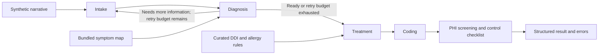

# Medical Multi-Agent System

[](https://github.com/HenryVarro666/medical-multi-agent-system/actions/workflows/ci.yml)
[](pyproject.toml)
[](LICENSE)

A Python research prototype that runs a synthetic patient narrative through five stages: intake, diagnosis, treatment, coding, and audit. LangGraph controls the workflow, and FastAPI exposes the pipeline and deterministic lookup tools.

The project demonstrates agent orchestration, retrieval traces, deterministic drug-interaction checks, and reproducible evaluation artifacts. It is not clinically validated, HIPAA certified, or intended for patient care. Use synthetic data only.

Adapted from [bcefghj/medical-multi-agent-system](https://github.com/bcefghj/medical-multi-agent-system), under the MIT license. See [attribution and project history](ATTRIBUTION.md).

## What runs today

- Four LLM stages produce structured intake, diagnosis, treatment, and coding outputs. A deterministic audit stage screens outputs with limited PHI regex patterns and marks deployment controls as unverified.
- Diagnosis retrieves candidates from a small, bundled symptom-to-disease map and includes the retrieval trace in its output. The default pipeline does not query Neo4j or a literature corpus.
- Treatment reconciles LLM suggestions with curated drug-interaction and allergy rules. These rules are illustrative and incomplete.
- ICD-10 lookup and simplified DRG grouping use bundled mappings. They do not replace a complete coding catalog or certified grouper.
- Evaluation records per-run outputs, scoring, errors, and latency for five synthetic vignettes.

## Quick start

Use Python 3.11 or newer; `.python-version` selects Python 3.12 for uv. Run these commands from the repository root:

```bash
python3 -m venv .venv
source .venv/bin/activate
python -m pip install -e '.[dev]'
cp .env.example .env
```

Set `OPENAI_API_KEY` in `.env` to use the default OpenAI backend. Alternatively, point the application at an already running OpenAI-compatible model server:

```dotenv
OPENAI_BASE_URL=http://localhost:8001/v1
OPENAI_API_KEY=local
OPENAI_MODEL=your-served-model
```

The model server is a separate dependency and is not launched by this repository. Keep it on a different port from the API. `LLM_DISABLE_THINKING` defaults to `false`; enable it only if the server supports `chat_template_kwargs.enable_thinking`.

Start the API:

```bash
uvicorn medical_multi_agent.api.main:app --host 127.0.0.1 --port 8000
```

Open [Swagger UI](http://127.0.0.1:8000/docs) or [ReDoc](http://127.0.0.1:8000/redoc). The health, ICD-10, and DDI endpoints work without an LLM. Full analysis requires a working configured backend. `/health` checks the API process, not model readiness.

For an installation using the committed dependency lockfile, use uv:

```bash
uv sync --extra dev --locked
uv run uvicorn medical_multi_agent.api.main:app --host 127.0.0.1 --port 8000
```

## Try the API

A deterministic interaction check:

```bash
curl -s http://127.0.0.1:8000/api/v1/clinical/ddi/check \
  -H 'Content-Type: application/json' \
  -d '{"new_drugs":["warfarin"],"current_drugs":["aspirin"]}'
```

Run a bundled synthetic vignette through the full pipeline:

```bash
python - <<'PY'
import json
from pathlib import Path
import httpx

case = json.loads(Path("data/sample_patients.json").read_text())[0]
response = httpx.post(
    "http://127.0.0.1:8000/api/v1/clinical/analyze",
    json={"patient_description": case["description"]},
    timeout=600,
)
response.raise_for_status()
print(json.dumps(response.json(), indent=2))
PY
```

Inspect the returned `errors` list as well as the HTTP status; individual agent failures can produce partial results. See the [API reference](docs/api.md).

## Workflow



Retries reprocess the same narrative; the API does not collect new information from a user. Once the retry budget is exhausted, the current workflow proceeds with the available information. See [architecture and limitations](docs/architecture.md).

## Evaluation

The [historical run from July 13, 2026](evaluation/results/historical-2026-07-13/eval_results.md) contains ten recorded runs of five synthetic cases with `Qwen/Qwen3-14B`:

| Recorded measure | Historical result |
|---|---:|
| Top-1 diagnosis, strict alias tier | 6/10 |
| Top-1 diagnosis, either alias tier | 10/10 |
| Exact ICD-10 match | 5/10 |
| ICD-10 category match | 10/10 |
| Mean pipeline latency | 28.22 s |

These are historical demo measurements, not results for the current refactor. Diagnosis scoring uses substring aliases; it does not assess clinical correctness. Repeats reuse the same five cases, labels have not been independently validated, and there is no baseline comparison or demonstrated GraphRAG improvement. The historical files retain their original wording and outputs for traceability.

After configuring a backend, create a new run:

```bash
python -m evaluation.run_eval --help
python -m evaluation.run_eval --repeats 2
python -m evaluation.run_eval --cases case_001 --output-dir /tmp/clinical-eval-new
```

New outputs default to an ignored, timestamped directory under `evaluation/results/runs/`. Historical results and nonempty output directories cannot be overwritten by the runner. See [evaluation methods and reproduction limits](evaluation/README.md).

## Development

```bash
python -m pytest
python -m ruff check .
```

The automated tests exercise the graph and agents with synthetic fixtures and mocked model calls; they also cover the API and evaluation runner. They do not require an LLM or clinical data. CI checks Python 3.11, 3.12, and 3.13, builds the package, and runs container smoke tests. A live evaluation is a separate check requiring a model backend.

```text
src/medical_multi_agent/   Agents, graph, API, models, configuration, services
data/                     Five synthetic vignette fixtures
tests/                    Offline regression tests
evaluation/               Scoring, runner, and historical artifacts
docs/                     Architecture and API reference
```

## Docker

```bash
cp .env.example .env
# Configure the backend in .env before full analysis.
docker compose up --build
```

Compose runs the API alone. For a model server running on the host, set `OPENAI_BASE_URL=http://host.docker.internal:8001/v1`. PostgreSQL and Redis are not used by the default pipeline. Neo4j connection helpers are optional and are not wired into diagnosis retrieval.

## Scope and limitations

The audit stage runs after LLM calls and does not redact the returned patient data. Remote model configuration sends narrative and intermediate data to the selected endpoint. This application has no authentication or durable audit storage. FHIR conversion helpers are experimental, are not invoked by the pipeline, and have not been validated against an external FHIR server.

The project is licensed under [MIT](LICENSE). Contributions should preserve the evidence boundaries described in [CONTRIBUTING.md](CONTRIBUTING.md).
